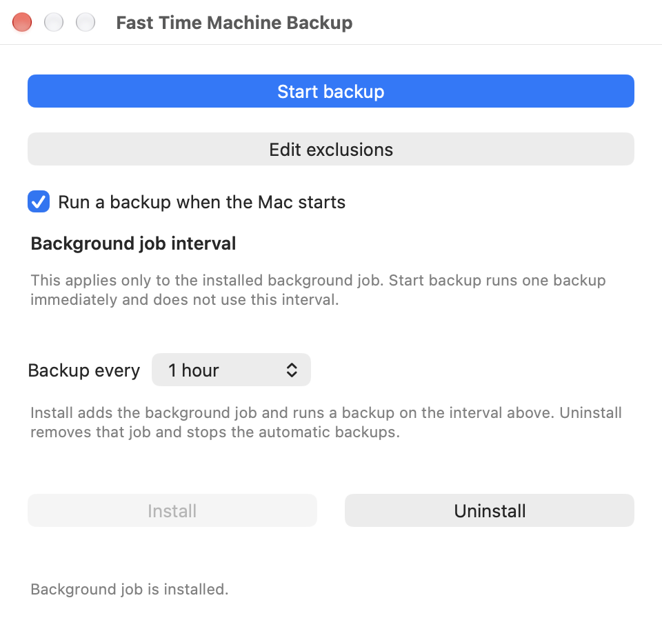
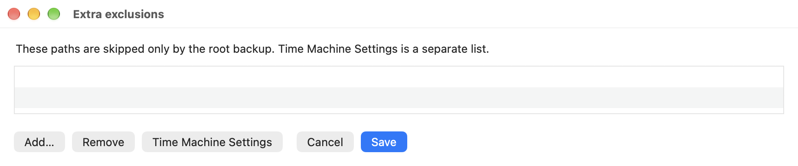

# Fast Time Machine Backup

A small macOS app that runs Time Machine on a schedule. It backs up every destination already set in Time Machine, and it can skip extra folders that System Settings will not add.

Automatic Time Machine backups stay off in System Settings. This app is the scheduler.





## Requirements

- macOS. Built and tested on macOS 27.2.1 (build 26B131), Apple Silicon.
- A Time Machine destination already saved in System Settings. The app reads that list. A destination can be a local disk or a network volume (SMB, AFP, or NFS).
- An administrator password to install or remove the background job, and to run a backup from the app.
- Swift command-line tools, if you build it yourself. Tested with Swift 6.4.2. Xcode is not required.

## What the app does

**Start backup** asks for an administrator password, then runs one backup immediately. It does not wait for the interval.

**Edit exclusions** opens the extra exclusion list. Those paths are skipped only by a backup this app starts. Time Machine Settings is a separate list and is not changed. The list is kept in `Resources/exclusions.txt` inside the app, one path per line. A line starting with `#` is ignored. Paths are shown in alphabetical order. The list in this repository is empty.

**Background job interval** applies only to the installed background job. The choices run from 15 minutes to 24 hours.

**Run a backup when the Mac starts** is available only while the background job is installed. It runs one backup at startup. It does not change the macOS setting for app background activity.

**Install** adds the background job and runs a backup on the interval above. The button is disabled while the job is installed.

**Uninstall** asks for an administrator password, then removes the background job and stops the automatic backups. The button is disabled while the job is not installed. The app stays in Applications. Backups already stored by Time Machine stay. The exclusion list stays in the app.

Installing, uninstalling, and starting a backup ask for an administrator password, because the backup runs as root.

## What one backup does

The backup runs as root. It reads the destinations with `tmutil destinationinfo` and backs up each one. Extra exclusions are marked for every destination, then removed when the run exits.

Transfer optimizations are used only for a remote destination, and only while that destination is being copied. A local disk does not get them. For a remote volume the app turns the AirDrop radio off and turns the low-priority disk throttle off. For an SMB volume it also writes `/etc/nsmb.conf` with signing off, change notifications off, and SMB3 only, then unmounts an open Time Machine network volume so the new connection uses those settings. An AFP or NFS volume does not get the SMB file. When the remote copy finishes, the radio, the throttle, and the SMB file are put back.

Before a remote copy, the app waits until that volume's host answers a ping or a connection on its protocol port (445 for SMB, 548 for AFP, 2049 for NFS). The host comes from the destination URL. If that host stays unreachable, that destination is skipped and any other destination still runs.

The exclusion marks cover only the paths in `Resources/exclusions.txt`.

A second run does not start while one is already going. The log is `/var/log/local.fasttimemachine.backup.log`.

## Build and install

```bash
./build.sh
cp -R build/TimeMachineBackup.app /Applications/
```

Open **Fast Time Machine Backup** from Applications. `./build.sh` writes `build/TimeMachineBackup.app` and does not replace an app that is already in Applications.

## Uninstall

To remove the app itself:

1. Open **Fast Time Machine Backup**.
2. Click **Uninstall** and enter an administrator password. This removes the background job. If a backup is already running, wait until it finishes, then click **Uninstall** again.
3. Quit the app.
4. Delete **Fast Time Machine Backup** from Applications.

Backups already stored by Time Machine stay. Time Machine Settings is not changed. The log file `/var/log/local.fasttimemachine.backup.log` is left on the Mac.

## License

MIT. See [LICENSE](LICENSE).
