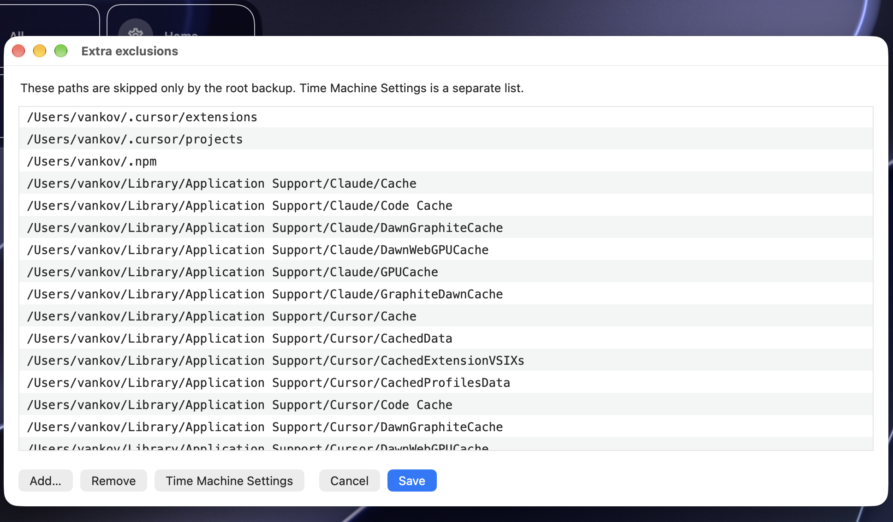

# Fast Time Machine Backup

A small macOS app that runs Time Machine on a schedule, and speeds the copy up while that one backup is running.

It is built for a backup stored on a Synology NAS (a DS220+) over SMB. Automatic Time Machine backups stay off in System Settings. This app is the scheduler.



## What the window does

**Start backup** runs one backup immediately. It does not wait for the interval.

**Edit exclusions** opens the extra exclusion list. Those paths are skipped only by a backup this app starts. Time Machine Settings is a separate list and is not changed. The list is kept in `Resources/exclusions.txt`, one path per line. A line starting with `#` is ignored. Paths are shown in alphabetical order.

**Background job interval** applies only to the installed background job. The choices run from 15 minutes to 24 hours.

**Run a backup when the Mac starts** is available only while the background job is installed. It runs one backup at login. It does not change the macOS setting for app background activity.

**Install** adds the background job and starts it on the interval above. **Uninstall** removes that job. Install is disabled while the job is installed. Uninstall is disabled while it is not.

Installing or uninstalling asks for an administrator password, because the job is a system launch daemon.

## What one backup does

The backup runs as root. While it runs, and only while it runs, the app:

1. Waits until the NAS answers. It pings `DS220plus`, then `10.0.0.5`. If neither answers, the run is skipped.
2. Turns the AirDrop radio (`awdl0`) off, so Wi-Fi is not shared with AirDrop during the copy.
3. Turns off the low-priority disk throttle (`debug.lowpri_throttle_enabled`), so Time Machine is not held back.
4. Writes `/etc/nsmb.conf` with SMB signing off, change notifications off, and SMB3 only. An existing Time Machine volume is unmounted first, because a connection that is already open keeps the old settings.
5. Marks the extra exclusion paths on the folders themselves, with the Time Machine exclusion attribute. It also marks every `node_modules` folder under `/Users/vankov/Projects`, `/Users/vankov/Install`, and the Cursor agent worker storage. The marks are removed when the backup exits, including when it fails.
6. Runs `tmutil startbackup --auto --block`.
7. Unmounts the Time Machine volume again, and puts the network, the throttle, and the SMB config back the way they were.

A second run does not start while one is already going. The log is `/var/log/com.vankov.tmbackup.log`.

## Change it for another Mac

In `Sources/TimeMachineBackup`, change the NAS name and address in the ping loop, and change the three folders searched for `node_modules`.

Edit `Resources/exclusions.txt` for the extra paths, or use **Edit exclusions** in the app after it is installed.

## Build and install

Xcode is not required. The Swift command-line tools are.

```bash
./build.sh
cp -R build/TimeMachineBackup.app /Applications/
```

Open **Fast Time Machine Backup** from Applications. The copy already in `/Applications` on this Mac is the installed app. Rebuilding here does not replace it until that `cp` is run.

## License

MIT. See [LICENSE](LICENSE).
